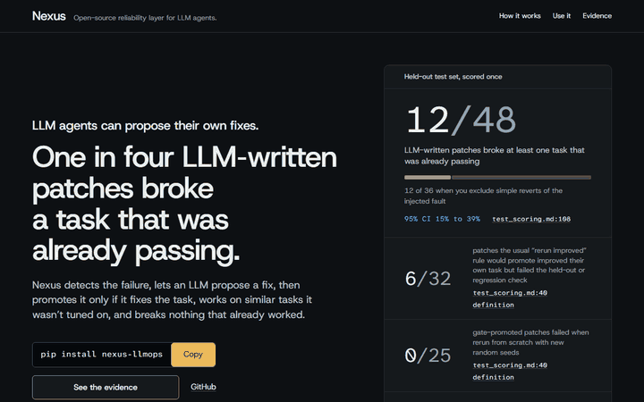
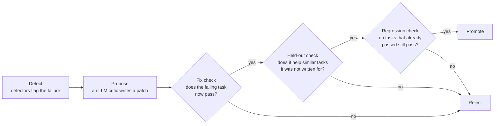
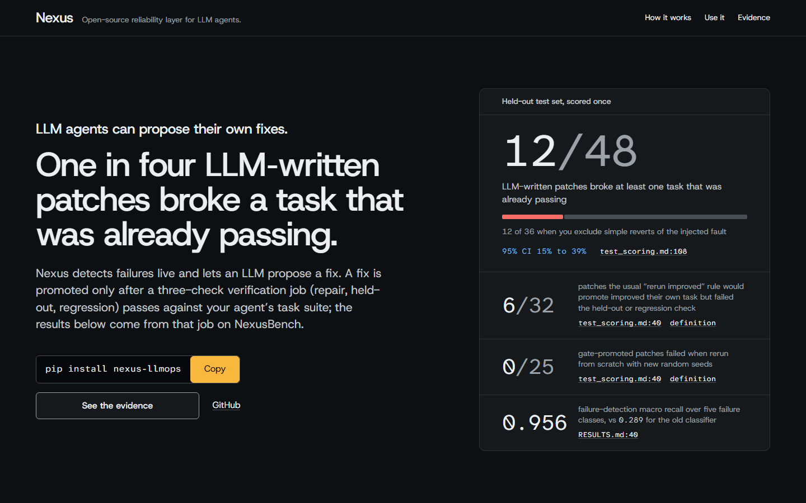
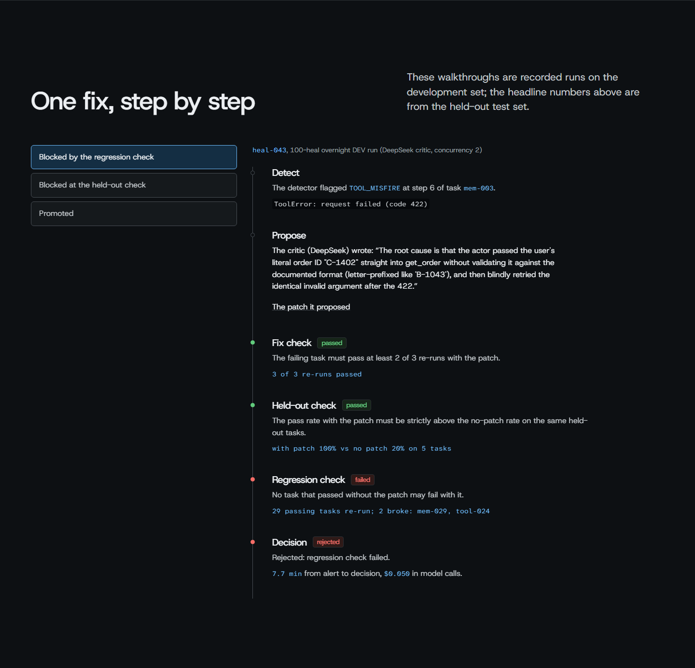

# Nexus

**An open-source reliability layer for LLM agents.** Nexus detects when an agent run fails, lets an LLM
propose a fix, and promotes the fix only if it repairs the failing task, works on similar tasks it was not
written for, and breaks nothing that already worked.

- **Demo:** https://nexus-llmops.vercel.app (a static replay of recorded runs; no backend, no keys)
- **SDK:** [`nexus-llmops` on PyPI](https://pypi.org/project/nexus-llmops/): `pip install nexus-llmops`
- **Every number below** links to the committed file and line it comes from. [RESULTS.md](RESULTS.md) has all of them.



## The problem

Agents fail quietly. A loop, a wrong tool call or an invented fact, and the run still returns an answer.

An LLM can read the failed trace and propose a fix, usually a change to the agent's instructions. The usual
way to accept that fix is to rerun the failing task and ship the fix if it now passes. That check only looks
at one task. It never looks at the tasks that already worked.

## What Nexus does



1. **Detect.** Detectors read each finished trace and flag the failure: a loop, a tool misfire, leaked
   context, a drifting plan or an invented fact.
2. **Propose.** An LLM critic reads the trace and writes a patch to the agent's instructions.
3. **Fix check.** The failing task is rerun with the patch; it must pass at least 2 of 3 reruns.
4. **Held-out check.** Held-out tasks are similar tasks the patch was not written for. With the patch, their
   pass rate must be strictly higher than without it.
5. **Regression check.** Regression tasks are ones that already passed. None of them may fail with the patch.
6. **Promote or reject.** A patch that passes all three checks is promoted. Anything else is rejected.



<!-- readme-numbers:start -->

## The finding

From the held-out test set: a separate set of tasks, locked away until the method was frozen, then scored
once. Intervals are 95% Wilson intervals.

| Number | What it means | 95% interval | Source |
|---|---|---|---|
| 12/48 | LLM-written patches broke at least one task that was already passing. | 15% to 39% | [test_scoring.md:108](reports/phase4/test_scoring.md?plain=1#L108) |
| 12/36 | The same 12, counted only over patches that did more than undo the injected fault (excluding simple reverts). | 20% to 50% | [test_scoring.md:27](reports/phase4/test_scoring.md?plain=1#L27) |
| 21/36 vs 4/36 | Those patches fixed their own task 21 times; rerunning the same failures with no patch fixed 4. | 42% to 73% vs 4% to 25% | [test_scoring.md:27](reports/phase4/test_scoring.md?plain=1#L27) |
| 6/32 | Of the 32 patches the usual "rerun improved" rule would promote, 6 were false promotions: they improved their own task but failed the held-out or regression check ([definition](reports/phase4/preregistration.md?plain=1#L183)). | 9% to 35% | [test_scoring.md:40](reports/phase4/test_scoring.md?plain=1#L40) |
| 0/25 | Patches the gate promoted that failed when rerun from scratch with new random seeds. | 0% to 13% | [test_scoring.md:40](reports/phase4/test_scoring.md?plain=1#L40) |
| 0.956 vs 0.289 | Failure-detection macro recall over five failure classes, against the old classifier. | not reported (sealed file) | [RESULTS.md:40](RESULTS.md?plain=1#L40) |

### Where the critic helps, by kind of failure

Share of test-set failures that ended with a promoted fix. The generic template is the old fallback fix
for each failure class, mapped to a change by a fixed rule, with no LLM.

| Failure class | LLM critic | Generic template | Source |
|---|---|---|---|
| Loops | 8/12 (39% to 86%) | 0/12 (0% to 24%) | [test_scoring.md:69](reports/phase4/test_scoring.md?plain=1#L69) |
| Tool misfires | 6/12 (25% to 75%) | 0/12 (0% to 24%) | [test_scoring.md:66](reports/phase4/test_scoring.md?plain=1#L66) |
| Invented facts (hallucination) | 11/12 (65% to 99%) | 12/12 (76% to 100%) | [test_scoring.md:65](reports/phase4/test_scoring.md?plain=1#L65) |
| Plan drift | 0/12 (0% to 24%) | 0/12 (0% to 24%) | [test_scoring.md:68](reports/phase4/test_scoring.md?plain=1#L68) |
| Context bleed | 0/3 | 0/3 | [test_scoring.md:67](reports/phase4/test_scoring.md?plain=1#L67) |

- Loops and tool misfires together: 14/24 (39% to 76%) for the critic, 0/24 (0% to 14%) for the template. These two intervals are computed from the summed counts. Sources: [test_scoring.md:69](reports/phase4/test_scoring.md?plain=1#L69), [test_scoring.md:66](reports/phase4/test_scoring.md?plain=1#L66).
- For invented facts, one plain rule does as well as the critic: undo the injected instruction. Plan drift is unsolved by either. Context bleed has only 3 eligible failures. Sources: [test_scoring.md:65](reports/phase4/test_scoring.md?plain=1#L65), [test_scoring.md:67](reports/phase4/test_scoring.md?plain=1#L67).

### Why the test set is scored once

| Set | Patches that broke a passing task | 95% interval | Source |
|---|---|---|---|
| Development set, where the critic was tuned | 3/44 | 2% to 18% | [test_scoring.md:107](reports/phase4/test_scoring.md?plain=1#L107) |
| Held-out test set | 12/48 | 15% to 39% | [test_scoring.md:108](reports/phase4/test_scoring.md?plain=1#L108) |

A number measured where you tuned flatters you.

## How it works

<picture>
  <source media="(prefers-color-scheme: dark)" srcset="docs/assets/nexus-architecture-dark.png">
  
</picture>

The live stack runs the detectors and the critic as services. The three-check promotion gate runs in the
evaluation harness that produced the results above (`bench/heal/`, `services/healer/gate.py`); the live
healer service still runs the older evaluation loop.

Speed and cost, measured on one laptop with the full stack running (development data):

| Measure | Value | Source |
|---|---|---|
| Time to alert, from an agent's last span to a failure alert | 0.01 s median, 0.81 s at p95 | [RESULTS.md:111](RESULTS.md?plain=1#L111) |
| Time to a checked decision, for a heal that ran all three checks | 446 s median (about 7.4 minutes) | [heal_latency_cost.json:284](results/phase5/heal_latency_cost.json#L284) |
| Model cost per heal (every heal, promoted or not) | about $0.031 mean | [heal_latency_cost.json:506](results/phase5/heal_latency_cost.json#L506) |
| Model cost per promoted fix | about $0.043: $3.08 for all 100 heals, divided by the 72 that were promoted | [heal_latency_cost.json:506](results/phase5/heal_latency_cost.json#L506) |
| SDK overhead added to each agent step | 0.042 ms median, 0.141 ms at p99 | [RESULTS.md:106](RESULTS.md?plain=1#L106) |
| Ingestion, sustained with every latency checkpoint met | 30 events/s | [headline.json:713](results/phase5/headline.json#L713) |

The regression rerun takes most of the time to a decision. Costs are provider-reported usage at published
rates, not an invoice.

## Honest limits

- **Plan drift is unsolved.** The critic promoted 0/12 plan-drift fixes. Source: [test_scoring.md:68](reports/phase4/test_scoring.md?plain=1#L68).
- **Two detection targets were missed.** Of the traces flagged as invented facts, 0.81 were right, against a 0.90 target ([RESULTS.md:37](RESULTS.md?plain=1#L37)). Normal traces drew 56.0 false alerts per 1,000, against a target of 10 ([RESULTS.md:38](RESULTS.md?plain=1#L38)). These are the primary results.
- **The label correction came after scoring.** A relabelling criterion, registered before the one-time test scoring and applied afterwards to stored predictions, gives precision 0.973 and 8.5 false alerts per 1,000. Source: [RESULTS.md:39](RESULTS.md?plain=1#L39).
- **The benchmark world is invented.** All results come from real agent runs in an invented task world with injected faults ([DATASHEET.md:17](bench/DATASHEET.md?plain=1#L17)). Detection was also checked on HaluEval and ToolBench ([RESULTS.md:41](RESULTS.md?plain=1#L41)). Healing hasn't been tested on real production failures.
- **One laptop, one critic draw.** Speed is from one machine. The critic runs at temperature 0.2, so a rerun can write a different patch. Source: [c1.json:7](results/critic_dev/c1.json#L7).
- **Lite mode is partial.** It has no hallucination detector and no LLM critic, and uses SQLite instead of Kafka. Source: [RESULTS.md:112](RESULTS.md?plain=1#L112).

<!-- readme-numbers:end -->

## Use it



Quickstart with lite mode (Docker; one container, no API keys, deterministic detectors only):

```bash
git clone https://github.com/sankalp-rajeev/Nexus.git
cd Nexus
docker compose -f docker-compose.lite.yml up -d --build   # collector on http://127.0.0.1:18000
```

Install the SDK:

```bash
pip install nexus-llmops
```

Trace an agent (save as `example.py`, run `python example.py`):

```python
import nexus_llmops as nexus

nexus.init(agent_name="my-pipeline", collector_url="http://127.0.0.1:18000")

@nexus.trace(span_type="tool_call")
def search(query: str) -> str:
    return "results for " + query

@nexus.trace(span_type="agent_step")
def run(task: str) -> str:
    return search(task)

run("find the order")
nexus.flush()
```

See the trace and its classification:

```bash
curl http://127.0.0.1:18000/v1/lite/snapshot
```

Already on OpenTelemetry? Point your OTLP exporter at the collector's `/v1/traces`
([how spans map](docs/otel_mapping.md)):

```bash
export OTEL_EXPORTER_OTLP_TRACES_ENDPOINT=http://127.0.0.1:18000/v1/traces
export OTEL_EXPORTER_OTLP_PROTOCOL=http/protobuf
```

Full stack (Kafka, Postgres, the LLM critic and the gate; collector on `http://localhost:8000`, API on 8001,
dashboard on 3000). Use `collector_url="http://localhost:8000"` and port 8000 in the OTLP endpoint:

```bash
cp .env.example .env    # add GEMINI_API_KEY, or set NEXUS_LLM=mock
docker compose up --build
```

The SDK's own README is [sdk/README.md](sdk/README.md); changes are in [CHANGELOG.md](CHANGELOG.md).

## Evidence

- [RESULTS.md](RESULTS.md): every result row with its provider, model, commit, file and 95% interval. It is
  generated by `scripts/build_results_md.py`; never edit it by hand. `python scripts/build_results_md.py --check`
  verifies it.
- [reports/](reports/): one report per phase and step, including the preregistrations and the one-time
  test scoring.
- [DECISIONS.md](DECISIONS.md): every decision that changed a plan, with its reason.
- The demo page's data, `dashboard/public/replay.json`, is exported from committed results by
  `dashboard/scripts/export_replay.py` and checked in CI.

To reproduce:

```bash
python -m venv .venv
.venv/Scripts/activate            # Windows; source .venv/bin/activate elsewhere
pip install -e sdk/ -r requirements-dev.txt
python scripts/phase5/pytest_dev_only.py -p no:deepeval tests/unit tests/e2e
python scripts/build_results_md.py --check
python dashboard/scripts/export_replay.py --verify
```

The test split is sealed: its numbers appear only as already reported, and the scripts never reopen it.
Phase 5 (the overnight heal runs behind the speed and cost numbers) reproduces at commit `75771ab`.

## License

[MIT](LICENSE)
