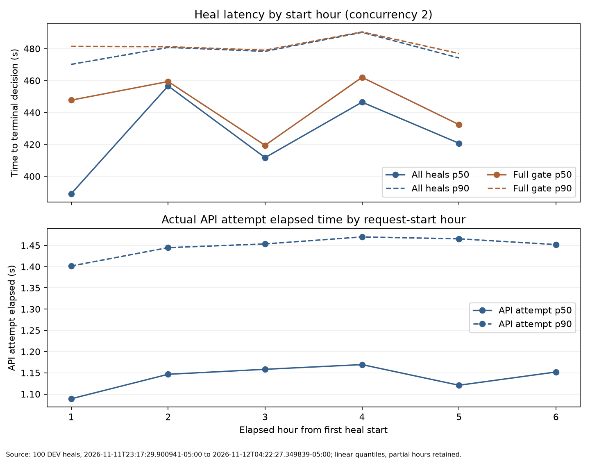

# Phase 5 results

## Part A: L1 latency and L2 cost

DEV only; fixed concurrency 2. All 100 registered occurrences are retained. Smoke is excluded from per-heal endpoints and reconciled separately below.

Run: 2026-11-11T23:17:29.900941-05:00 to 2026-11-12T04:22:27.349839-05:00.

Fast exit means rejected with all three gate stages recorded as skipped. Full gate means all three completed. No duration threshold is used; partial/interrupted cases have their own retained group.

### L1: seconds, point estimate [bootstrap 95% CI]

| Recorded-stage group | n | p50 seconds [95% CI] | p90 seconds [95% CI] |
|---|---:|---:|---:|
| all_heals | 100 | 421.641 [411.732, 447.714] | 480.419 [474.185, 489.092] |
| fast_exit | 18 | 7.619 [6.522, 8.475] | 13.940 [8.151, 15.945] |
| full_gate | 82 | 446.178 [422.422, 454.524] | 483.234 [477.542, 489.798] |
| partial_or_interrupted | 0 | n/a | n/a |

Percentile bootstrap: 10,000 resamples, fixed seed 2026111201, occurrence-level sampling; linear quantiles. CIs are conditional on this run and do not eliminate time correlation or repeated-source-task dependence.

### Per-stage latency and aggregate share of total time

| Stage | Ran | Skipped | p50 seconds [95% CI] | p90 seconds [95% CI] | Share of all-heal total |
|---|---:|---:|---:|---:|---:|
| detect | 100 | 0 | 0.000863 [0.000675, 0.000993] | 7.542 [7.467, 7.876] | 0.9203% |
| classify | 100 | 0 | 0.000302 [0.000290, 0.000342] | 0.001172 [0.001140, 0.001312] | 0.0002% |
| critic_call | 100 | 0 | 8.155 [7.922, 8.259] | 13.798 [9.150, 14.891] | 2.3354% |
| gate_repair | 82 | 18 | 15.296 [13.474, 16.633] | 20.440 [19.453, 21.249] | 3.4234% |
| gate_heldout | 82 | 18 | 74.275 [63.618, 79.485] | 91.531 [88.705, 99.040] | 16.3627% |
| gate_regression | 82 | 18 | 337.714 [332.137, 346.589] | 366.289 [358.094, 372.843] | 76.8886% |

Unattributed loading/configuration/final bookkeeping: 0.07% of total. Stage quantiles exclude explicitly skipped stages, whose counts remain visible. The JSON also includes stage distributions/shares separately for fast exits and full-gate heals.

### L2: main-run cost and tokens per heal

| Metric | Mean | Median | Total |
|---|---:|---:|---:|
| ledger_usd | 0.07085755 | 0.08101335 | 7.08575550 |
| provider_usd | 0.03075956 | 0.03774435 | 3.07595610 |
| input_tokens | 187493.93 | 214206.00 | 18749393.00 |
| cache_hit_input_tokens | 114103.16 | 133348.50 | 11410316.00 |
| cache_miss_input_tokens | 73390.77 | 84306.50 | 7339077.00 |
| output_tokens | 12174.48 | 13299.50 | 1217448.00 |

Provider/ledger ratio of totals: **0.434104**. Token-weighted input cache-hit rate: **60.86%**. The cost gap includes both cache discounts and time-of-day pricing; it is not a cache-only effect. Provider dollars price API-reported usage at the registered schedule, not an invoice.

### Latency by elapsed hour

Heals are bucketed by start time; API attempts by their own request start. Final partial hours are retained. Full-gate-only and per-request views help expose fast-exit mix effects. These observational differences do not isolate provider load.

| Run hour | Start (local offset) | Heals (fast/full) | All p50/p90 s | Full gate p50/p90 s | API p50/p90 s | API attempts |
|---|---|---:|---:|---:|---:|---:|
| 1 | 2026-11-11T23:17:29.900941-05:00 | 26 (8/18) | 389.089/470.149 | 447.731/481.409 | 1.089/1.402 | 5899 |
| 2 | 2026-11-12T00:17:29.900941-05:00 | 17 (1/16) | 456.625/480.770 | 459.394/481.226 | 1.147/1.445 | 5701 |
| 3 | 2026-11-12T01:17:29.900941-05:00 | 19 (3/16) | 411.732/478.309 | 419.437/479.034 | 1.158/1.454 | 5675 |
| 4 | 2026-11-12T02:17:29.900941-05:00 | 18 (2/16) | 446.467/490.209 | 462.025/490.484 | 1.169/1.470 | 5651 |
| 5 | 2026-11-12T03:17:29.900941-05:00 | 20 (4/16) | 420.729/474.168 | 432.416/476.929 | 1.121/1.466 | 5774 |
| 6 | 2026-11-12T04:17:29.900941-05:00 | 0 (0/0) | n/a/n/a | n/a/n/a | 1.152/1.452 | 392 |

API-attempt p50 was 1.089s in hour 1, peaked at 1.169s in hour 4, and was 1.121s in hour 5. The full-gate hourly medians are non-monotonic. This shows modest request-time drift, not evidence that provider load alone caused the variation.

### Errors, timeouts and retries

- `terminal_heal_status`: {"ok": 100}
- `api_attempts`: 29092
- `api_error_total`: 0
- `api_error_counts`: {}
- `http_status_counts`: {"200": 29092}
- `unknown_or_unsettled_api_attempts`: 0
- `missing_provider_usage`: 0
- `heal_timeout_count`: 0
- `recorded_api_timeout_count`: 0
- `api_transport_retries_after_failed_request`: 0
- `critic_validation_retry_rounds`: 10
- `heals_without_critic_api_calls`: 4
- `critic_heals_by_retry_round_count`: {"0": 86, "1": 10}
- `critic_paid_requests_on_retry_rounds`: 20
- `agent_run_records`: 8610
- `agent_run_error_count`: 0
- `agent_run_retry_attempts`: 0
- `actor_invalid_json_responses`: 0
- `orphan_attempt_directories`: 0

Transport retries count failed API attempts; critic validation retries are separate generated proposals. Actor invalid JSON responses are model protocol errors/corrective turns, not transport retries. Four NORMAL detector outcomes made no paid critic request; their recorded critic-stage timer covers the no-op branch. All paid attempts, including retries, reconcile to the durable ledger; no heal or attempt was silently dropped.

### Gate decisions: descriptive only, not a re-estimate of Phase 4 rates

| Detector failure class | Promoted | Rejected | Other |
|---|---:|---:|---:|
| CONTEXT_BLEED | 0 | 11 | 0 |
| HALLUCINATION | 38 | 0 | 0 |
| LOOP_DETECTED | 23 | 0 | 0 |
| NORMAL | 0 | 4 | 0 |
| TOOL_MISFIRE | 11 | 13 | 0 |

### Budget reconciliation

Main 100: ledger $7.08575550, provider $3.075956103. Smoke: ledger $0.15867720, provider $0.082887528. Shared totals: ledger **$7.24443270**, provider **$3.158843631**. Caps: $9.00/$4.00; cap hit: False.

Source: registered DEV occurrence JSON plus the read-only SQLite API ledger and local actor/critic retry ledgers. Only aggregate results are committed; raw records remain ignored under `data/phase5/runs/`.
