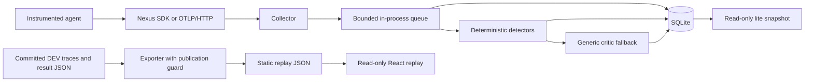

> **Superseded (2026-11-13):** replaced by the repository's [README.md](../../README.md). Kept for the record; do not update.

# Nexus

## Problem

An agent can finish without raising an exception while returning an unsupported
answer, mixing user context, abandoning its plan, retrying a bad tool call or
looping. Ordinary request logs do not explain the failure across an agent run.

Nexus records spans, assembles traces, detects these behaviors and presents
structured patch proposals for inspection. The evaluated detector results below
are separate from healing outcomes: Phase 4 gate decisions and end-to-end
healing results are **pending**. Lite mode uses deterministic detectors and
generic critic fallbacks; it makes no automatic healing claim.

## 60-second GIF placeholder

> **GIF placeholder: not recorded yet.** Show a trace arriving through OTLP,
> a detected repeated tool call, its alert, a generic fallback proposal, and the
> read-only replay inspector. Keep the pending-gate label visible. Replace this
> block with the actual recording before using the README as launch material.

## Results

The table is transcribed from [RESULTS.md on main](https://github.com/sankalp-rajeev/Nexus/blob/5ce13563f9475a9c5400e68d62a93bede60b23c2/RESULTS.md)
at commit `5ce1356`. Every numerical result, model identifier, date and source
commit in the table links directly to its committed `results/` JSON at that
same main revision. Historical TEST summaries are reproduced as published;
no TEST traces enter the DEV replay and no TEST experiment is rerun here.

**Mock** rows are schema/pipeline smoke checks, not evidence of real-model
quality. DEV measurements, final TEST measurements and sensitivity analyses
retain their original labels; they are not interchangeable.

| ID | Result | Provider / model | Mock | Date | Commit | File |
|---|---|---|---|---|---|---|
| [B0-dataset][b0-dataset] | [NexusBench: 716 labelled traces over 140 tasks; test split per class NORMAL=118, LOOP_DETECTED=29, TOOL_MISFIRE=38, CONTEXT_BLEED=30, PLAN_DRIFT=31, HALLUCINATION=36, OTHER_FAILURE=75][b0-dataset] | [deepseek+ollama / deepseek-flash + qwen2.5:7b-instruct][b0-dataset] | no | [2026-11-11][b0-dataset] | [`a04c528`][b0-dataset] | [results/bench_dataset.json][b0-dataset] |
| [B1][b1] | [label agreement 72/72 (hand vs automatic)][b1] | [human / hand labels][b1] | no | [2026-11-11][b1] | [`9c24e43+dirty`][b1] | [results/bench_labels.json][b1] |
| [A1-separability-dev][a1-separability-dev] | [CONTEXT_BLEED separability (dev): gate not tripped; best single rule account_tier_records >= 2][a1-separability-dev] | [none (no LLM) / trivial rules][a1-separability-dev] | no | [2026-11-11][a1-separability-dev] | [`1c23fe4`][a1-separability-dev] | [results/cb_separability_dev.json][a1-separability-dev] |
| [D0-baseline][d0-baseline] | [binary P=1.000 R=0.473 (TP=52 FP=0 FN=58 TN=110) on 220 real HaluEval/ToolBench traces][d0-baseline] | [none (no LLM) / svm.joblib v3 (scikit-learn SVM) + all-MiniLM-L6-v2 + cross-encoder/nli-MiniLM2-L6-H768][d0-baseline] | no | [2026-11-10][d0-baseline] | [`9ce9535`][d0-baseline] | [results/classifier_v3_baseline.json][d0-baseline] |
| [critic-smoke][critic-smoke] | [SMOKE TEST (mock LLM): 20/20 traces produced a schema-valid proposal; 20/20 were the generic fallback template][critic-smoke] | [mock / MockProvider][critic-smoke] | **mock** | [2026-11-10][critic-smoke] | [`9ce9535`][critic-smoke] | [results/critic_smoke_mock.json][critic-smoke] |
| [D-baseline-dev][d-baseline-dev] | [DEV baseline (shipped SVM): headline macro recall 0.3111; HALLUCINATION R=0.9333 P=0.1373, CONTEXT_BLEED R=0.0 P=None, PLAN_DRIFT R=0.0 P=None, TOOL_MISFIRE R=0.8824 P=1.0, LOOP_DETECTED R=1.0 P=0.85][d-baseline-dev] | [none (no LLM) / v3 classifier as shipped: rules + SVM over MiniLM embedding, PatchCore, io_divergence, NLI contradiction (data/classifier_model)][d-baseline-dev] | no | [2026-11-11][d-baseline-dev] | [`1c23fe4`][d-baseline-dev] | [results/detect_baseline_dev.json][d-baseline-dev] |
| [D-dev][d-dev] | [DEV detectors: headline macro 0.9222, secondary 1.0; FA/1000 NORMAL 41.0][d-dev] | [local NLI + rules (+gemini judge variant) / cross-encoder/nli-deberta-v3-base; judge gemini-3.5-flash-lite][d-dev] | no | [2026-11-11][d-dev] | [`bd6a318`][d-dev] | [results/detect_dev.json][d-dev] |
| [S-v1.1-dev][s-v1.1-dev] | [SENSITIVITY (v1.1 labels, dev): headline 0.9222; H P=0.9714 R=1.0][s-v1.1-dev] | [none (stored predictions) / frozen Phase 2 detectors][s-v1.1-dev] | no | [2026-11-11][s-v1.1-dev] | [`a04c528`][s-v1.1-dev] | [results/detect_dev_v11_sensitivity.json][s-v1.1-dev] |
| [D4][d4] | [external: HaluEval binary P=0.5465 R=0.7833; ToolBench binary P=1.0 R=1.0][d4] | [local NLI + rules / cross-encoder/nli-deberta-v3-base][d4] | no | [2026-11-11][d4] | [`d293ab6+dirty`][d4] | [results/detect_external.json][d4] |
| [D5][d5] | [TEST false alerts per 1,000 NORMAL: 56.0 (baseline 1000.0)][d5] | [local NLI + rules / cross-encoder/nli-deberta-v3-base][d5] | no | [2026-11-11][d5] | [`d293ab6+dirty`][d5] | [results/detect_false_alerts.json][d5] |
| [D6][d6] | [detector latency p50 0.4 ms, p95 674.1 ms (CPU); SDK overhead 0.01 ms/call][d6] | [local NLI + rules / cross-encoder/nli-deberta-v3-base][d6] | no | [2026-11-11][d6] | [`d293ab6+dirty`][d6] | [results/detect_latency.json][d6] |
| [D3][d3] | [dev PR curves / operating points: HALLUCINATION P=0.8571 R=1.0, CONTEXT_BLEED P=1.0 R=0.7667, PLAN_DRIFT P=1.0 R=1.0][d3] | [local NLI + rules / cross-encoder/nli-deberta-v3-base][d3] | no | [2026-11-11][d3] | [`bd6a318`][d3] | [results/detect_pr_dev.json][d3] |
| [D1][d1] | [TEST (once): headline macro recall 0.9556, secondary 1.0; H P=0.8108 R=1.0; CB P=1.0 R=0.8667; PD P=1.0 R=1.0][d1] | [local NLI + rules / cross-encoder/nli-deberta-v3-base][d1] | no | [2026-11-11][d1] | [`d293ab6+dirty`][d1] | [results/detect_test.json][d1] |
| [S-v1.1-test][s-v1.1-test] | [SENSITIVITY (v1.1 labels, stored test predictions): headline 0.9556; H P=0.973 R=1.0; FA/1000 8.5][s-v1.1-test] | [none (stored predictions) / frozen Phase 2 detectors][s-v1.1-test] | no | [2026-11-11][s-v1.1-test] | [`a04c528`][s-v1.1-test] | [results/detect_test_v11_sensitivity.json][s-v1.1-test] |
| [D2][d2] | [TEST headline macro recall 0.9556 vs SVM baseline 0.2889 (secondary 1.0 vs 0.4334)][d2] | [local NLI + rules / cross-encoder/nli-deberta-v3-base][d2] | no | [2026-11-11][d2] | [`d293ab6+dirty`][d2] | [results/detect_vs_baseline.json][d2] |
| [A3-entity-rule-dev][a3-entity-rule-dev] | [entity-absence rule alone (dev): P=0.8571 R=1.0][a3-entity-rule-dev] | [local NLI + Gemini judge (cached) / cross-encoder/nli-deberta-v3-base; gemini-3.5-flash-lite][a3-entity-rule-dev] | no | [2026-11-11][a3-entity-rule-dev] | [`284fb25`][a3-entity-rule-dev] | [results/phase2_entity_rule_dev.json][a3-entity-rule-dev] |
| [A2-independence-dev][a2-independence-dev] | [judge vs NLI (dev): 96 traces where either ran, 0 disagreements; shared step: retrieved_context][a2-independence-dev] | [local NLI + Gemini judge (cached) / cross-encoder/nli-deberta-v3-base; gemini-3.5-flash-lite][a2-independence-dev] | no | [2026-11-11][a2-independence-dev] | [`284fb25`][a2-independence-dev] | [results/phase2_independence_audit.json][a2-independence-dev] |
| Phase 4: healing gate decisions | **pending** | pending | pending | pending | pending | Awaiting finalized committed results |
| Phase 4: end-to-end healing outcomes | **pending** | pending | pending | pending | pending | Awaiting finalized committed results |

No Phase 4 scores, success rates or improvements are inferred from detector
recall or the mock critic smoke test.

## Architecture



Lite runs the collector, queue consumers, detectors and fallback in the same
process. It uses SQLite instead of Kafka, Postgres/Timescale, Redis and MLflow.
Its deterministic path covers loops, tool misfires, conflicting memory profiles
and plan drift. NLI hallucination scoring and LLM critics are outside lite mode.
Queued items are volatile until committed, and alerts can reflect incomplete
trace snapshots. Use lite for integration and inspection, not production
reliability or equivalence to the evaluated full detector pipeline.

The static replay has no API, WebSocket, keys or mutation controls. Its exporter
only reads committed blobs from an explicit allowlist, checks DEV membership
against labels and task splits, and retains source blob hashes. The current
replay contains clearly marked mock template excerpts and placeholder gates;
**publication is blocked**. A recursive guard rejects placeholder/mock strings
and keys anywhere in the data, including provenance and notices, and rejects
illustrative/excerpt-only proposals. There is no bypass flag. Replacing only
the visible warning text cannot make the current artifact publishable.

## Quickstart

Run these commands from a checkout of `phase-6-demo`. No API keys are needed
for lite or static replay. Docker validation is still deferred.

### Lite mode

In a Python virtual environment, from the repository root:

```bash
python -m pip install -e ./sdk -r services/collector/requirements-lite.txt
```

Start the process in PowerShell:

```powershell
$env:NEXUS_QUEUE = 'inprocess'
$env:NEXUS_SQLITE_PATH = 'services/collector/nexus-lite.db'
$env:NEXUS_LLM = 'mock'
python -m uvicorn services.collector.main:app --host 127.0.0.1 --port 18000 --workers 1
```

POST native Nexus spans to `http://127.0.0.1:18000/v1/spans`, or configure an
OTel HTTP exporter with
`OTEL_EXPORTER_OTLP_TRACES_ENDPOINT=http://127.0.0.1:18000/v1/traces` and
`OTEL_EXPORTER_OTLP_TRACES_PROTOCOL=http/protobuf`. Inspect
`http://127.0.0.1:18000/v1/lite/snapshot` and `/health`.
See [the OTLP field mapping](../../docs/otel_mapping.md) for input/output and attribute
preservation. Keep the worker count unchanged: the queue is process-local.

For a later, separately scheduled container validation, the equivalent entry
is `docker compose -f docker-compose.lite.yml up --build`. This draft does not
claim that the container path has been validated.

### Replay

With Node, Python and Git available:

```powershell
cd dashboard
npm.cmd ci
npm.cmd run build:replay
```

**This build intentionally fails with the current committed replay sources.**
They still contain mock templates and placeholder gates. No override is
provided. Replace them with finalized, committed DEV proposals and gate
results, update the exporter and replay display together, then run the same
command again. Do not remove evidence markers to make the check pass.

Once the publication guard passes, serve the generated static build:

```powershell
python -m http.server 4173 --bind 127.0.0.1 --directory dist
```

Open `http://127.0.0.1:4173`. On shells without PowerShell's script policy
restriction, use `npm` in place of `npm.cmd`. Do not publish a stale `dist/`
from a failed build. The prepared `dashboard/vercel.json` selects the guarded
replay build and static output, with Git auto-deployments disabled. It has
not been linked to a Vercel project or deployed; future Vercel setup must use
`dashboard` as the project Root Directory and retain access to the repository's
committed data and Git metadata during export.

## How results are produced

NexusBench captures agent executions with controlled faults and labels the
observed behavior. Task-level DEV/TEST splits prevent the same task from
crossing evaluation roles. See the [dataset artifact][b0-dataset] and
[label agreement artifact][b1] for the published corpus and audit.

Detectors receive a sanitized production-style trace view rather than gold
labels or fault-injector ownership metadata. Operating points are selected on
DEV under the preregistered rule, then frozen for the final TEST evaluation.
The reported pipeline combines deterministic rules with local NLI; optional
judge variants and label-sensitivity analyses remain separate result rows.
The [detector comparison][d2] and [external evaluation][d4] are distinct
measurements, not projected healing benefits.

Experiment scripts write committed JSON artifacts with provider, model, mock
status, seed, timestamp and source commit provenance. The existing
`scripts/build_results_md.py` generates `RESULTS.md` from those artifacts.
Check the generated index without changing it:

```bash
python scripts/build_results_md.py --check
```

This draft only transcribes the pinned main results table. It adds no new
benchmark measurements. Unit tests validate behavior and publication blocking;
they do not establish detector or healing quality. The replay export itself
runs no benchmarks, detectors or LLMs and never includes TEST traces. Phase 4
rows remain pending until finalized evidence is committed and incorporated
through the results index.

[b0-dataset]: https://github.com/sankalp-rajeev/Nexus/blob/5ce13563f9475a9c5400e68d62a93bede60b23c2/results/bench_dataset.json
[b1]: https://github.com/sankalp-rajeev/Nexus/blob/5ce13563f9475a9c5400e68d62a93bede60b23c2/results/bench_labels.json
[a1-separability-dev]: https://github.com/sankalp-rajeev/Nexus/blob/5ce13563f9475a9c5400e68d62a93bede60b23c2/results/cb_separability_dev.json
[d0-baseline]: https://github.com/sankalp-rajeev/Nexus/blob/5ce13563f9475a9c5400e68d62a93bede60b23c2/results/classifier_v3_baseline.json
[critic-smoke]: https://github.com/sankalp-rajeev/Nexus/blob/5ce13563f9475a9c5400e68d62a93bede60b23c2/results/critic_smoke_mock.json
[d-baseline-dev]: https://github.com/sankalp-rajeev/Nexus/blob/5ce13563f9475a9c5400e68d62a93bede60b23c2/results/detect_baseline_dev.json
[d-dev]: https://github.com/sankalp-rajeev/Nexus/blob/5ce13563f9475a9c5400e68d62a93bede60b23c2/results/detect_dev.json
[s-v1.1-dev]: https://github.com/sankalp-rajeev/Nexus/blob/5ce13563f9475a9c5400e68d62a93bede60b23c2/results/detect_dev_v11_sensitivity.json
[d4]: https://github.com/sankalp-rajeev/Nexus/blob/5ce13563f9475a9c5400e68d62a93bede60b23c2/results/detect_external.json
[d5]: https://github.com/sankalp-rajeev/Nexus/blob/5ce13563f9475a9c5400e68d62a93bede60b23c2/results/detect_false_alerts.json
[d6]: https://github.com/sankalp-rajeev/Nexus/blob/5ce13563f9475a9c5400e68d62a93bede60b23c2/results/detect_latency.json
[d3]: https://github.com/sankalp-rajeev/Nexus/blob/5ce13563f9475a9c5400e68d62a93bede60b23c2/results/detect_pr_dev.json
[d1]: https://github.com/sankalp-rajeev/Nexus/blob/5ce13563f9475a9c5400e68d62a93bede60b23c2/results/detect_test.json
[s-v1.1-test]: https://github.com/sankalp-rajeev/Nexus/blob/5ce13563f9475a9c5400e68d62a93bede60b23c2/results/detect_test_v11_sensitivity.json
[d2]: https://github.com/sankalp-rajeev/Nexus/blob/5ce13563f9475a9c5400e68d62a93bede60b23c2/results/detect_vs_baseline.json
[a3-entity-rule-dev]: https://github.com/sankalp-rajeev/Nexus/blob/5ce13563f9475a9c5400e68d62a93bede60b23c2/results/phase2_entity_rule_dev.json
[a2-independence-dev]: https://github.com/sankalp-rajeev/Nexus/blob/5ce13563f9475a9c5400e68d62a93bede60b23c2/results/phase2_independence_audit.json
